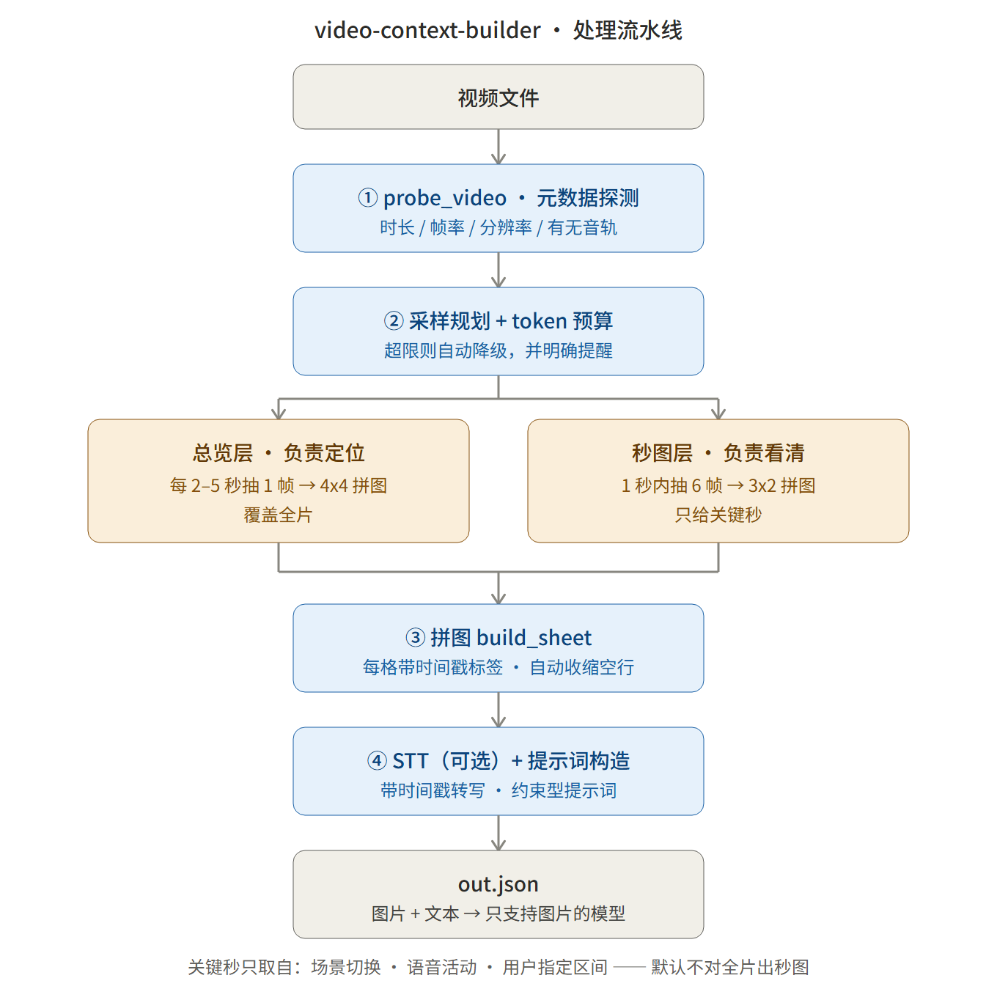
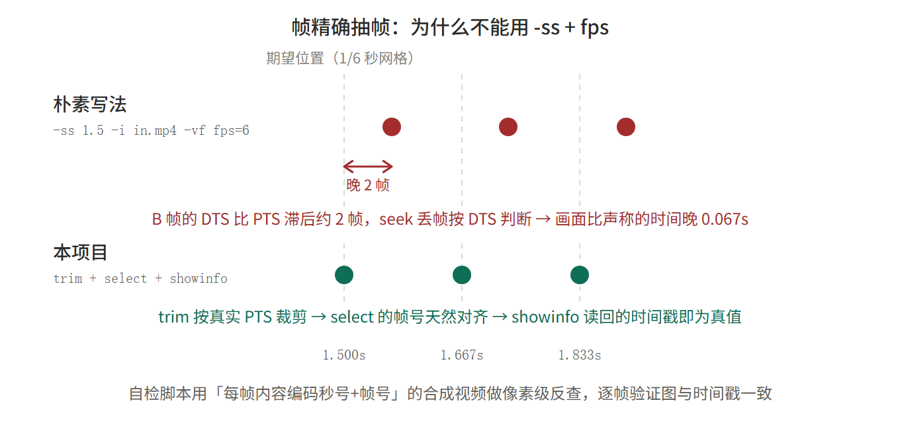

# video-context-builder

把视频转换成**只有图片理解能力、没有视频输入能力**的多模态模型也能消费的「视频上下文包」。

一次调用产出：视频元数据 + 总览拼图 + 关键秒的**秒图** + 可选 STT 时间戳转写 + 约束型提示词 + token 估算与超限提醒。

## 自适应采样

默认 `auto` 现在结合有效视频时长与 token 预算决定实际密度，`adaptive` 为同义入口。
短视频优先连续总览；长视频均匀覆盖全程，再在各时间段内优先查看场景变化、语音和与问题匹配的转写关键词。
自适应总览默认 3×2 拼图，局部图默认 2 秒窗/6 帧。传统显式模式保留原有参数档案。

```bash
# 不指定预算：按有效时长自动选 6k–40k 总预算
python scripts/build_video_context.py --video input.mp4 --mode auto --out out.json

# 总预算包含回答、安全余量与补看预留；给问题可影响局部采样
python scripts/build_video_context.py --video input.mp4 --mode auto --max-tokens 12000 --question "什么时候拿起钥匙？" --out out.json
```

| 区间时长 | 总览目标间隔 | 自动总预算示例 |
|---|---|---|
| 不超过 1 分钟 | 0.5 秒 | 30 秒 7k，60 秒 8k |
| 1–5 分钟 | 1 秒 | 5 分钟 11k |
| 5–20 分钟 | 2 秒 | 10 分钟 14k，20 分钟 18k |
| 20–60 分钟 | 4 秒 | 60 分钟 29k |
| 超过 60 分钟 | 8 秒 | 最多 40k |

目标密度受预算和帧上限约束，不保证每个视频都达到表中数值。
默认预留 10% 安全余量、15% 补看和约 10% 回答（256–2048 token）；12000 总预算时本轮输入最多 7800。
最终图片和提示词会复算，转写只计一次。看 `budget.ready_to_send`、`budget.input_limit`、
`coverage.largest_unsampled_gap_sec` 和实际 `frame_timestamps` 了解能否发送及真实覆盖。

预算针对一次主请求；分段 map/reduce 是替代调用路线，其累计 map 输入单独报告，还需为各段输出及 reduce 分配预算。
预留的补看需要调用方维护累计账本。脚本不会自动调用模型，也没有自动多轮补看。
模型预设的 token 是近似估算，安全余量不保证实际账单误差上限。

完整策略见 [自适应采样说明](references/adaptive-sampling.md)；
轻量 STT 选型见 [STT 模型建议](references/stt-models.md)。目前支持本地 faster-whisper 和可配置的 OpenAI 兼容转写 API。

### STT API：安装后一次配置

复制根目录 `stt.example.json` 为 `stt.local.json`，填入服务地址、模型 ID 和密钥环境变量名。
密钥本身由用户在运行环境安全配置，不写入 JSON；默认读取 `STT_API_KEY`。
也支持 `STT_BACKEND / STT_API_BASE_URL / STT_API_MODEL` 等环境变量，或 `--stt-backend / --stt-api-*` 参数。

```bash
# 只检查配置与密钥存在性，不联网、不加载本地模型
python scripts/transcribe.py --check-config --stt-config stt.local.json

# 配置文件指定 backend=api 后，启用转写
python scripts/build_video_context.py --video input.mp4 --stt --stt-config stt.local.json --out out.json

# 显式切回本地
python scripts/build_video_context.py --video input.mp4 --stt --stt-backend local --out out.json
```

API 模式不需要 faster-whisper 或供应商 SDK；支持分块上传、原片时间偏移和单独记录服务 usage。
只返回文字时明确标注粗略时间范围；不自动重试或切换付费服务。
详细字段、Agent 配置步骤、输出格式兼容性及测试见 [STT API 配置](references/stt-api.md)。

```bash
python -m unittest discover -s scripts -p test_adaptive_sampling.py -v
python -m unittest discover -s scripts -p test_stt_api.py -v
```

下文固定采样表与固定模式帧上限用于兼容传统显式模式；默认 auto 使用上述自适应策略。

<picture>
  <source media="(prefers-color-scheme: dark)" srcset="docs/architecture-dark.png">
  
</picture>

---

## 为什么需要它

大多数多模态模型**不支持视频输入**。硬塞图片又容易踩两个坑：

- **帧太少** → 只看个大概，说不出细节；
- **帧太多** → token 爆炸，请求被拒或费用失控。

本工具用**分层采样 + 前置预算**解决：

| 层 | 做法 | 作用 | 覆盖范围 |
|---|---|---|---|
| 总览层 | 每 2–5 秒抽 1 帧，拼成 4x4 / 5x5 | 快速**定位**：视频大致讲了什么、结构如何 | 全片 |
| 秒图层 | 1 秒内抽多帧（默认 6 帧），拼成 3x2 的**秒图** | 看清**细节**：动作分解、瞬间表情、画面变化 | 只给关键秒 |

关键秒只从「场景切换 / 语音活动 / 用户指定区间」里挑，**默认不对整段长视频全量生成秒图**。
处理前先估算 token，超限就明确提醒并给出降级方案 —— **绝不静默把几百张图丢给模型**。

---

## 安装

```bash
pip install -r requirements.txt
```

最少只需要两个包，其中 `imageio-ffmpeg` **自带 ffmpeg 二进制，无需系统安装**：

```bash
pip install Pillow imageio-ffmpeg
```

| 包 | 作用 | 缺失时行为 |
|---|---|---|
| `faster-whisper` | STT 音频转写 | 自动跳过 STT，输出里说明原因，**不报错** |
| `tiktoken` | 更准的文本 token 估算 | 退回内置启发式估算 |
| `imageio-ffmpeg` | 提供 ffmpeg 二进制 | 若系统已装 ffmpeg 可省 |

> 本工具**不需要 torch**：faster-whisper 底层是 ctranslate2，CPU + int8 就能跑。
> GPU 加速：`--whisper-device cuda --whisper-compute-type float16`。

---

## 快速开始

```bash
# 1. 看一眼视频底细
python scripts/probe_video.py input.mp4

# 2. 生成上下文包（auto：按有效时长与预算自适应采样）
python scripts/build_video_context.py --video input.mp4 --mode auto --stt \
    --max-tokens 50000 --out out.json

# 3. 自检（自动合成测试视频，逐项验证全部验收标准）
python scripts/selfcheck.py
```

### 用 Python 调用

```python
import sys; sys.path.insert(0, "scripts")
from build_video_context import build_video_context

ctx = build_video_context(
    "input.mp4",
    mode="auto",              # auto / quick / standard / deep / long-video / custom-range
    stt=True,                 # None = 按模式默认
    max_tokens=50000,
    custom_range=None,        # (120, 180) 或 "120-180"
    cell=224,
    second_frames=6,
    model_preset="qwen-vl",   # 影响 token 估算口径
    question="视频里第 3 分钟那个人说了什么？",
)

print(ctx["token_estimate"])     # {'images': 9272, 'text': 580, 'total': 9852}
print(ctx["budget"]["message"])  # token 估算 9852 <= 上限 50000（占比 20%，帧 67/96）
print(ctx["prompt"])             # 直接发给目标模型的提示词
```

### 发给目标模型时怎么组装

**只发图片和文本。**

```python
import json, base64, pathlib

ctx = json.loads(pathlib.Path("out.json").read_text(encoding="utf-8"))

def data_url(p):
    return "data:image/jpeg;base64," + base64.b64encode(pathlib.Path(p).read_bytes()).decode()

content = [{"type": "text", "text": ctx["prompt"]}]
# 顺序必须与提示词里的「材料清单」一致：总览图 → 秒图 → 原图
for s in ctx["overview_sheets"] + ctx["second_sheets"] + ctx.get("original_frames", []):
    content.append({"type": "image_url", "image_url": {"url": data_url(s["path"])}})
```

---

## 六种模式

| 模式 | 触发 | 总览 | 秒图 | STT | 帧上限 | 典型 token |
|---|---|---|---|---|---|---|
| `quick` | 只想知道大概 | 1–2 张 4x4 | 无 | 关 | 32 | ~3k |
| `standard` | **默认** | 有 | 关键秒 | 开 | 96 | ~10k |
| `deep` | 要看清细节 | 5x5 + 关键段 | 关键段 | 开 | 200 | ~25k |
| `long-video` | 时长 >= 10 分钟 | 有 + 分段 | 关键段 | 开 | 128 | ~19k |
| `custom-range` | 指定时间段 | 区间内 | 区间内逐秒 | 开 | 112 | 与区间长度成正比 |
| `auto` / `adaptive` | 默认 | 按时长和预算规划，3×2 总览 | 关键片段 2 秒窗 | 开 | 动态 | 动态 |

### 采样密度怎么算

两层密度不同，**都能在输出 JSON 的 `sampling_plan` 里查到**：

- 总览层：每 `overview_interval` 秒 1 帧（默认 2–5 秒，即 0.2–0.5 帧/秒）
- 秒图层：每张覆盖 1 秒抽 `second_frames` 帧（默认 6 → **6 帧/秒**），但只覆盖被选中的关键秒

> **陷阱**：`--overview-interval 1` 不一定会得到 1 帧/秒。每个模式都有总览帧数上限
> （`overview_cap`：quick / standard / long-video = 32，deep = 50），超了会自动**放宽间隔**并在
> `warnings` 里说明。要真按固定间隔抽，必须**同时给 `--overview-cap`**：
>
> ```bash
> # 62 秒视频要每 1 秒 1 帧 → cap 必须 >= 63
> python scripts/build_video_context.py --video in.mp4 --mode deep \
>     --overview-interval 1.0 --overview-cap 70 --out out.json
> ```
>
> 确认实际密度请读 `out.json` 的 `sampling_plan.overview_interval` 与 `overview_frame_count`，
> **不要只信命令行参数**。

---

## CLI 参数

```
--video PATH              输入视频（必填）
--mode {auto,adaptive,quick,standard,deep,long-video,custom-range}   默认 auto
--stt / --no-stt          默认按模式：standard/deep 开，quick 关
--max-tokens N            auto/adaptive 总预算默认按时长选 6k–40k；传统模式默认 50000 输入预算
--response-tokens N       auto/adaptive 回答预留，默认约 10%，256–2048
--safety-ratio R          auto/adaptive 安全余量比例，默认 0.10
--revisit-ratio R         auto/adaptive 补看预留比例，默认 0.15
--range A-B               只处理该时间段，如 120-180 或 00:02:00-00:03:00
--out PATH                输出 JSON 路径（默认 <视频名>.video_context.json）
--out-dir PATH            拼图产物目录
--cell N                  每小格短边像素，默认 224（不建议低于 224）
--second-frames N         每张秒图帧数，默认 6
--second-layout CxR       秒图布局，默认 3x2
--overview-interval SEC   总览抽帧间隔，默认按模式
--overview-cap N          总览层最大采样帧数（默认按模式）
--overview-layout CxR     总览布局，默认 4x4（deep 为 5x5）
--max-frames N            总帧数上限（覆盖模式默认值）
--model-preset NAME       目标模型预设：generic/qwen-vl/gpt-4o/claude/glm-4v/internvl
--question TEXT           用户问题，追加到提示词末尾
--whisper-model NAME      tiny/base/small/medium/large-v3，或**本地模型目录路径**
--whisper-device auto     cpu / cuda / auto
--whisper-compute-type    int8 / float16 / int8_float16
--language zh             指定转写语言可提速提准
--max-transcript-chars N  转写文本字数上限，默认 6000（超出自动压缩）
--no-degrade              超预算时不自动降级，只提醒
--keep-temp               保留临时抽帧目录（排查用）
--quiet                   不打印进度
```

---

## 实现原理

### 1. 帧精确抽帧（本仓库最硬的一块）

朴素的 `ffmpeg -ss T -i in.mp4 -vf fps=N out_%d.jpg` 会**系统性错位 2 帧**（30fps 下 0.067 秒），
而且是**两个互相独立的原因**：

1. `-ss` 放在 `-i` 之前时，ffmpeg 丢弃「早于目标时间」的帧用的是 **DTS**；
   而 H.264/x264 默认带 B 帧，**DTS 比 PTS 滞后约 2 帧** → 实际解码起点比目标晚 2 帧。
   `-copyts` 只会改标签、不改内容，反而让时间戳「说谎」。
2. **`fps` 滤镜自身有取帧偏移** —— 实测即使输入起点完全正确，`fps=6` 的第一个输出帧仍可能是第 2 帧。

实测对比（用「每帧内容编码了秒号与帧号」的合成视频定量验证）：

<picture>
  <source media="(prefers-color-scheme: dark)" srcset="docs/frame-accuracy-dark.png">
  
</picture>

本仓库采用的帧精确方案：

```bash
ffmpeg -copyts -ss <目标-1s> -t <长度> -i video \
  -vf "trim=start=<目标>:end=<结束>,select='not(mod(n,K))',showinfo,scale='min(960,iw)':-2" \
  -fps_mode passthrough
```

| 参数 | 作用 |
|---|---|
| `-copyts` + 预卷 1 秒 | **只为提速**（从目标前 1 秒开始解码），不依赖其标签精度 |
| `trim=start=..:end=..` | 按**真实 PTS** 裁剪，帧级精度（注意多选项用**冒号**分隔） |
| `select='not(mod(n,K))'` | `n` 从 trim 后第一帧算起，而那一帧恰好落在目标时间 → **天然自对齐** |
| `showinfo` | 打印每个输出帧的真实 `pts_time`，代码**直接读它当时间戳**，不靠推算 |
| `-fps_mode passthrough` | 关掉 ffmpeg 默认补帧，否则 image2 会把选中帧复制成 CFR，产生重复图 |

**验证方式**：`scripts/selfcheck.py` 合成一段「第 n 秒底色唯一标识秒号、帧内灰块亮度标识帧号」的测试视频，
跑完整流水线后**从生成的拼图里读回像素**，反推「第几秒第几帧」，再与 JSON 里声明的时间戳逐帧比对。
这是「时间戳准确到秒」的自动化证据，不依赖人眼。

### 2. 分层采样与 token 预算

`plan_sampling()` 在**不抽任何帧**的前提下先算账：

- 总览帧数由 `overview_interval` 与 `overview_cap` 共同决定，超上限则自动放宽间隔；
- 秒图张数 =（总帧预算 − 总览帧数）÷ 每张帧数；
- 用源视频宽高比 + 布局 + 格子尺寸**预测**出拼图成品尺寸（最后一张不满还会收缩），据此估图像 token；
- 与当前输入限额比较，超限时分散保留全程时间点并写入 `warnings`，抽帧后按实际材料再次核算。

### 3. 秒图与时间戳标签

`build_sheet()` 把帧拼成网格，每小格左下角烧上 `#序号 MM:SS` 标签，
同时保证**每小格短边不低于 `--cell`**（默认 224）—— 低于这个尺寸主流多模态模型读不清细节。
帧数不满整行时画布会自动收缩，不留大片空白。

### 4. 关键段检测

`pick_key_seconds()` 三级优先：

1. **场景切换** —— 用 ffmpeg 的 `select='gt(scene,0.3)'` + `metadata=print` 拿镜头切点，
   零额外依赖、流式扫描不吃内存；
2. **语音活动** —— 取 STT segments 的起始秒（有讲解的地方信息密度高）；
3. **均匀补点** —— 预算还有富余时按时间等距铺开，保证覆盖面。

三类候选做「最小间隔 1 秒」去重，超额时按步长抽稀，避免全挤在开头。

### 5. 长视频 map-reduce

`mode=long-video` 时输出 JSON 多一个 `map_reduce` 字段，把整片按 120 秒切段，
每段带上落在该段的图 + 一份 `map_prompt`，再加一个 `reduce_prompt_template`。

执行顺序：**逐段 map（每段一次请求）→ 收集摘要 → reduce（一次汇总请求）**。
单次请求的图片量可控，中途某段失败也能只重试那一段。
**本工具不调用视频理解模型**，只准备材料 + 提示词 + 预算；选择 API STT 时会调用已配置服务转写音轨。

### 6. 处处优雅降级

| 缺失/异常 | 行为 |
|---|---|
| 没装 ffprobe | 退化为解析 `ffmpeg -i` 的 stderr |
| 没装 ffmpeg | 提示 `pip install imageio-ffmpeg`（自带二进制） |
| 没装 faster-whisper | 跳过 STT，`transcript_info.status = "unavailable"` |
| 视频无音轨 | 跳过 STT，`status = "skipped"` |
| 模型拉取失败（网络/SSL） | `status = "error"` 并给出可操作提示，主流程不中断 |
| 老版本 ffmpeg 不认 `-fps_mode` | 自动退回 `-vsync 0` |
| 超 token 预算 | 提醒 + 自动降级 + 给模式建议（`--no-degrade` 可改为只提醒） |

---

## 输出 JSON

```jsonc
{
  "meta": {"duration": 20.0, "fps": 30.0, "has_audio": false,
           "width": 640, "height": 360, "nb_frames": 600, "path": "..."},
  "mode": "standard",
  "range": [0.0, 20.0],
  "custom_range": null,

  "overview_sheets": [
    {"path": ".../overview_00_0s.jpg", "layout": "4x4", "cols": 4, "rows": 4,
     "cells": 7, "sheet_width": 1602, "sheet_height": 528,
     "start": 0.0, "end": 18.0, "interval": 3.0}
  ],
  "second_sheets": [
    {"path": ".../second_0005_11s.jpg", "start": 11.0, "end": 12.0,
     "frames": 6, "layout": "3x2", "timestamp": "00:11",
     "frame_timestamps": [11.0, 11.167, 11.333, 11.5, 11.667, 11.833],
     "sheet_width": 1202, "sheet_height": 528}
  ],
  "original_frames": [],                     // 仅 deep 模式：重要帧原图

  "transcript": [{"start": 0.0, "end": 2.34, "text": "..."}],
  "transcript_info": {"status": "ok|skipped|unavailable|error", "reason": "", "language": "zh",
                      "truncated": false, "char_count": 1234},

  "prompt": "你是一个视频理解助手。……",

  "token_estimate": {"images": 9272, "text": 580, "total": 9852},
  "token_breakdown": {"overview": 1102, "second": 8170, "originals": 0,
                      "prompt": 580, "transcript": 0},
  "budget": {"max_tokens": 50000, "over_budget": false, "ratio": 0.197,
             "message": "token 估算 9852 <= 上限 50000（占比 20%，帧 67/96）"},

  "sampling_plan": {"overview_interval": 3.0, "overview_layout": "4x4",
                    "overview_frame_count": 7, "second_layout": "3x2",
                    "second_frames_per_sheet": 6, "second_sheet_count": 10,
                    "frames_total": 67, "max_frames": 96, "degraded": false},

  "warnings": ["..."],
  "assets_dir": "...",
  "model_preset": "generic",
  "elapsed_sec": 1.8,

  "map_reduce": { ... }                      // 仅 long-video 模式
}
```

---

## 自检

```bash
python scripts/selfcheck.py              # 6 个用例 / 57 项断言
python scripts/selfcheck.py -k short     # 只跑某一类
python scripts/selfcheck.py --keep       # 保留产物便于目检
```

| 用例 | 验证内容 |
|---|---|
| `short` | 30 秒视频生成总览图 + 秒图 + prompt；**像素级反查时间戳**；无音轨自动跳过 STT；临时目录清理 |
| `quick` | quick 不生成秒图且 ≤32 帧；custom-range 只处理指定区间 |
| `budget` | 超预算产生提醒 + 自动降级 + 给出 quick/--range 建议；`--no-degrade` 时如实报告超限 |
| `long` | 10 分钟视频不生成 600 张秒图；帧数与 token 受控；map_reduce 分段计划完整 |
| `stt` | 有音轨时走正常 STT 路径（失败也优雅降级） |
| `stt-pipeline` | 转写时间戳渲染、长转写压缩、进入提示词（离线可跑，不依赖模型下载） |

---

## 在真实视频上的实测

| 视频 | 时长 | 模式 | 总览 | 秒图 | 抽出帧数 | token |
|---|---|---|---|---|---|---|
| 黑白漫画分镜歌词 MV | 33.0s | standard | 每 3.0s 1 帧 × 11 | 10 张 | 71 / 990（7.2%） | ~8.5k |
| 同上（加密抽帧） | 33.0s | deep | 每 1.0s 1 帧 × 33 | 20 张 | 153 / 990（15.5%） | ~21k |
| 3D 动画短片 | 62.2s | deep | 每 1.24s 1 帧 × 50 | 25 张 | 200 / 1866（10.7%） | ~28k |

其中第一条视频**自身烧了时码**，生成的总览图标签与之逐格吻合 —— 在真实素材上独立佐证了帧精确抽帧。

---

## 作为 Agent Skill 使用

仓库根目录的 `SKILL.md` 是给 AI Agent 用的操作手册（含触发词、模式选择规则、排障表）。
把整个目录复制到 `~/.workbuddy/skills/video-context-builder/` 即可被 Agent 直接调用。

---

## 文件结构

```
video-context-builder/
├── README.md
├── SKILL.md                    # Agent 使用说明
├── LICENSE
├── requirements.txt
├── docs/
│   ├── architecture.svg        # 流水线图源文件（浅色）
│   ├── architecture.png        # 渲染产物（浅色 / 深色）
│   ├── architecture-dark.png
│   ├── frame-accuracy.svg      # 帧精确抽帧原理图源文件
│   ├── frame-accuracy.png
│   ├── frame-accuracy-dark.png
│   └── build_docs.py           # 生成深色版 + 渲染 PNG
├── scripts/
│   ├── ffmpeg_utils.py         # ffmpeg/ffprobe 定位与调用（含 imageio-ffmpeg 兜底）
│   ├── probe_video.py          # 元数据探测（ffprobe 优先，ffmpeg stderr 兜底）
│   ├── extract_frames.py       # 帧精确抽帧：等间隔 / 时间窗密集 / 单帧原图
│   ├── make_contact_sheet.py   # 拼图引擎（网格 + 时间戳标签 + 自动收缩空行）
│   ├── make_second_sheets.py   # 关键段检测 + 秒图生成
│   ├── transcribe.py           # STT（faster-whisper，可选，优雅降级）
│   ├── token_estimator.py      # token 估算与预算检查
│   ├── prompt_builder.py       # 提示词构造（含 map/reduce 模板）
│   ├── build_video_context.py  # 主编排器 + CLI
│   └── selfcheck.py            # 端到端自检
└── examples/
    ├── short_video.md          # 30 秒短视频 walkthrough
    ├── long_video.md           # 12 分钟长视频 map-reduce walkthrough
    └── demo_output/            # 真实跑出来的产物
```

---

## 已知边界

- **不调用目标模型**。只生产「材料 + 提示词 + 预算」，请求由调用方发起。
- **token 估算没有固定误差保证**。当前预设为近似值，不同厂商的缩放、切块和计费口径不同，
  估算值用于预算控制与超限提醒，**不是计费依据**。
- **「动作剧烈」用 scene_score 近似**。ffmpeg scene 滤镜给的是帧间差异分，对镜头切换敏感，
  对「同一镜头内的快速动作」不如光流敏感。
- **不是连续感知**。秒图之间没有采样，两段秒图之间对模型是空白 —— 本质上是「带时间戳的分镜稿 + 歌词本」，
  不是「看过视频」。
- **超长视频（>1 小时）** 建议直接用 `--mode long-video` 或先 `--range` 切段。

---

## License

[MIT](LICENSE)
